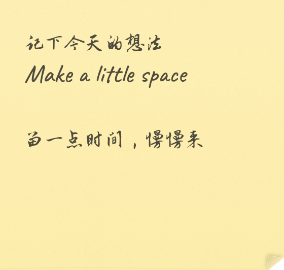
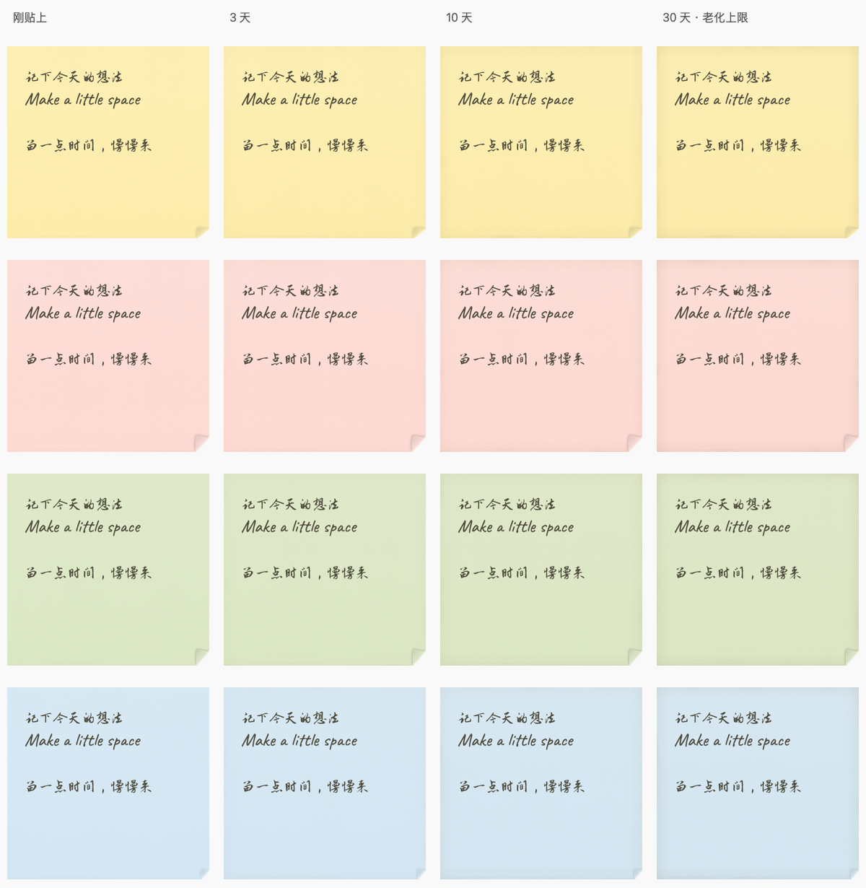

# StickyNote for AI · 贴贴

把对话里的待办和想法，贴到 Mac 桌面。

**贴贴（PaperMemory）** 是用 Swift / AppKit 编写的原生便签应用。你可以直接在纸上写，也可以让支持 MCP 的 AI 写入、更新、附上图片，并参考已有内容归类。

没有顶栏和额外标题。小便签展开后仍是同一张纸，文字、图片与上下文放在里面。

<p align="center">
  
</p>

*图片由应用的实际纸面绘制代码生成，使用示例文字。*

## 能做什么

- **多张桌面便签**：固定大小、多行文字，直接编辑、自动保存。支持贴在桌面层，或浮在其他窗口上方。
- **同窗展开**：点击右下角展开为大便签，粘贴或拖入图片；右上角缩小，保留原来的位置。
- **手写排版**：中英文配套的楷书、行书、草书，默认行书；三档字号、四种纸色，选中文字可快速划掉。
- **纸张和动作**：稳定的随机卷角、背面与折痕阴影，贴上和从右下角撕走的动画；快速拖放后有惯性缓停。
- **随时间变旧**：前 6 小时保持干净，之后纸边逐渐留下淡淡痕迹，30 天达到上限；正文与图片保持清晰。
- **AI 可调用**：本机 MCP 与 JSON CLI 共用同一份数据，支持创建、查询、修改、归类、图片导入和完成后恢复。

置顶时，右上角会出现小锁；点一下解除置顶并放回桌面。删除会移入“已收起”，可以恢复。

<details>
<summary>查看不同纸色与纸龄的效果</summary>



这是按固定时间模拟的生产渲染对照；纸龄来自创建时间，编辑、移动、重启和恢复不会重置。

</details>

## 在 Mac 上运行

目前的构建目标是 **Apple Silicon、macOS 14 或更新版本**。开发和验证需要 Xcode Command Line Tools，测试另需 Python 3。

```sh
xcode-select --install  # 尚未安装命令行工具时执行
git clone https://github.com/novono/StickyNoteforAI.git
cd StickyNoteforAI
./build.sh
open build/PaperMemory.app
```

构建不需要在线模型、API Key、Swift 包依赖或额外下载字体。生成的应用位于 `build/PaperMemory.app`，采用本地 ad-hoc 签名，未做 Apple 公证。仓库中的字体、图标和授权文件会一起打包。

如需固定安装位置，可以在退出正在运行的贴贴后复制到自己的“应用程序”目录：

```sh
mkdir -p "$HOME/Applications"
ditto build/PaperMemory.app "$HOME/Applications/PaperMemory.app"
open "$HOME/Applications/PaperMemory.app"
```

也可以指定输出位置：`./build.sh /absolute/path/PaperMemory.app`。

## 日常操作

| 操作 | 用法 |
| --- | --- |
| 新建 | 菜单栏图标或便签右键 → 新建便签 |
| 写字 | 直接在小便签或展开后的纸面输入，自动保存 |
| 调整样式 | 左上角入口，依次选择颜色、字号、书体 |
| 划掉文字 | 选中文字，在浮层或右键菜单中切换删除线 |
| 图片和长内容 | 点击右下角展开，再粘贴或拖入图片 |
| 收起详情 | 右上角缩小、Esc，或双击纸面空白边缘 |
| 移动 | 拖动纸面空白边缘；快速释放后缓停，再次按住即可停住 |
| 桌面 / 置顶 | 右键切换；置顶状态下点击右上角小锁可解除 |
| 恢复删除 | 菜单栏 → 所有便签 → 已收起，双击恢复 |

小便签为 280 × 266 pt，正面最多 60 个字符、6 行，实际输入还受所选字号的可用纸面限制。详情最多 20,000 字，最多 12 张图片，每个导入文件最多 20 MB。

“桌面小组件”使用应用自己的原生窗口，**不属于 WidgetKit 小组件图库**；贴贴需要保持运行。

## 接入 AI

应用同时是一个通过标准输入/输出通信的 MCP server。将应用内可执行文件作为命令，传入 `--mcp`：

```json
{
  "mcpServers": {
    "paper-memory": {
      "command": "/absolute/path/PaperMemory.app/Contents/MacOS/PaperMemory",
      "args": ["--mcp"]
    }
  }
}
```

将路径替换为实际的绝对路径，例如自己用户目录中的 `Applications/PaperMemory.app`。JSON 配置中的 `~` 不一定由客户端展开。不同客户端的配置位置和外层格式可能不同，命令与参数相同。

给 AI 的使用示例：

> 把刚才的待办贴到桌面，正面写两行，背景放进详情。
>
> 参考已有便签，把这些新事项归到合适的分类。
>
> 给这张便签附上这张截图；完成后帮我收起来。

AI 应先调用 `paper_context`，读取已有分类与便签，再决定创建还是更新。后续修改使用最新的 `expectedRevision`，防止覆盖手动编辑。分类与来源保存在便签背后的数据中，不显示为额外标题。

仓库提供可选的 [paper-memory skill](skill/SKILL.md)，包含写入、归类和冲突处理规则。将 `skill/` 安装到支持该格式的客户端技能目录即可使用。它的备用脚本会查找 `~/Applications/PaperMemory.app` 和 `/Applications/PaperMemory.app`，也支持用 `PAPER_MEMORY_APP` 指定应用路径。

**应用不内置大模型，也不监听飞书聊天。** 语义归类由调用它的 AI 完成；飞书等来源的内容可由用户提供，或由该 AI 已有的连接器读取后写入。

完整工具表、更新示例与 CLI 用法见 [AI 接口说明](docs/AI-INTEGRATION.md)。

## 本地数据

默认数据目录为 `~/Library/Application Support/PaperMemory`，也可以从菜单栏打开。便签、图片和富文本都保存在本机；应用没有网络服务端口。

更新使用文件锁、原子写入、备份和修订号检查。建议备份整个数据目录，不直接修改内部文件；AI 使用 MCP / CLI，手动编辑使用应用界面。

`PAPER_MEMORY_HOME` 可指定独立数据目录，`PAPER_MEMORY_NO_LAUNCH=1` 可禁止 AI / CLI 流程自动打开应用。测试已设置隔离数据目录，不使用日常便签。

## 开发与验证

```sh
./build.sh
./verify.sh
```

完整验证需要**已登录的 Mac 图形桌面会话**，会短暂打开独立测试窗口。覆盖 CLI/MCP、并发写入、修订冲突、图文保存、桌面层级、展开收起、贴撕动画、惯性拖动、纸张老化与阅读区域对比度。测试输出和生成的预览保留在 `build/check.*`。

只验证 CLI / MCP：

```sh
python3 Tests/test_integration.py
```

代码目录：

```text
Sources/
  main.swift       GUI、CLI、MCP 的入口
  App/             应用生命周期、窗口策略、便签列表
  Domain/          便签和附件模型
  Storage/         事务存储、附件、富文本
  Integration/     AI 指令与 MCP 协议
  UI/              大小便签、文本编辑和排版
  Paper/           纸张外观、纹理、老化、动画和拖动物理
Tests/             原生回归测试与 Python 集成测试
Resources/         字体、授权、图标、应用内使用说明
scripts/           字体和图标生成、视觉检查工具
skill/             AI 使用规则与 CLI 包装脚本
docs/              架构、开发和 AI 接口说明
```

更多内容：[架构与状态约束](docs/ARCHITECTURE.md) · [开发工具](docs/DEVELOPMENT.md) · [版本记录](CHANGELOG.md)

## 授权

应用源码采用 [MIT License](LICENSE)。内置字体及细笔衍生字体采用 **SIL Open Font License 1.1**，不由项目的 MIT 许可证替代。来源、改名说明和各字体完整授权见 [字体说明](Resources/FONT-SOURCES.md) 与 `Resources/*OFL.txt`。
