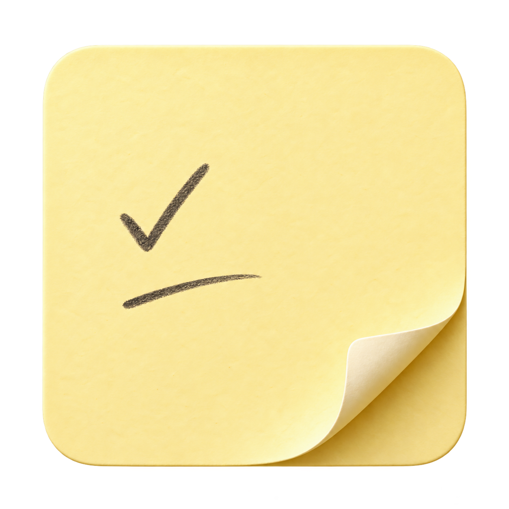

# 贴贴图标



图标就是一张干净的纸：奶油黄纸面、右下卷角、铅笔般的勾选与短笔迹。它与应用的纸张形态呼应，留出足够空白，在小尺寸下仍能辨认；没有文字、AI 字母、额外底板或装饰图案。

## 文件与导出

- 母版：[Resources/AppIcon.png](../Resources/AppIcon.png)，正方形透明 PNG。
- 应用资源：[Resources/AppIcon.icns](../Resources/AppIcon.icns)。
- 导出工具：[scripts/make-icon.swift](../scripts/make-icon.swift)，生成 16、32、128、256、512 pt 的 1× / 2× 版本。

```sh
mkdir -p build
xcrun swift scripts/make-icon.swift Resources/AppIcon.png build/AppIcon.iconset
iconutil -c icns build/AppIcon.iconset -o Resources/AppIcon.icns
./build.sh
```

图案由内置 imagegen 工具生成，再对透明边缘进行一次定向修整。导出阶段保留图案与透明度，只做尺寸转换；构建时不调用图像模型。

## 初始生成提示词

```text
Use case: logo-brand.
Asset type: finished macOS application icon for a native sticky note app named 贴贴 / PaperMemory. Produce ONE icon, square 1024 x 1024 composition, genuinely transparent background outside the object.
Primary request: an exceptionally restrained, tactile, clean sticky-note icon that looks like one real sheet of pale buttery yellow paper, centered and occupying about 86% of the canvas. The paper itself is the app icon silhouette; no extra tile, plate, badge, frame, or background behind it. Nearly frontal orthographic view, gently rounded upper corners, the bottom-right paper corner lifting and curling upward to reveal a warm cream underside. The curl must be readable at small sizes and cast a delicate realistic crease shadow. Subtle paper thickness and very fine clean fibres, never dirty, speckled, crumpled or stained. Soft studio light from top left, minimal soft contact shadow contained within transparent margins.
On the upper-middle left part of the paper, just two dark warm graphite handwritten strokes: the first a small graceful completed-task check mark, the second a short effortless curved horizontal pen stroke beneath it. Thin but legible, slightly irregular human pen pressure, lots of breathing room. No actual letters or words. Refined warm palette, physical but not glossy, bright clean paper, understated precision. A quiet native Mac productivity icon, crisp silhouette, simple geometry and beautiful paper curl.
Constraints: no text, no AI letters, no robot, no brain, no sparkles, no pencil, no border, no multiple cards, no grid of variants, no presentation mockup, no watermark. Preserve real alpha transparency.
```

## 透明边缘修整提示词

```text
Edit target: the provided finished sticky-note app icon. Keep the exact paper shape, pale buttery yellow palette, handwritten check and short line, bottom-right curled paper corner, lighting and composition. Change ONLY transparency cleanup: remove every detached fleck, bright edge artifact, stray colored pixel, dust and floating scrap outside the paper silhouette. Make the four transparent canvas corners and the margin above the paper completely empty with true alpha=0. The paper silhouette must have a clean smooth antialiased edge. Retain the continuous subtle paper shadow immediately around the object. No new elements, no labels, no background, no redesign. Deliver one production-ready macOS icon with real transparent margins.
```
